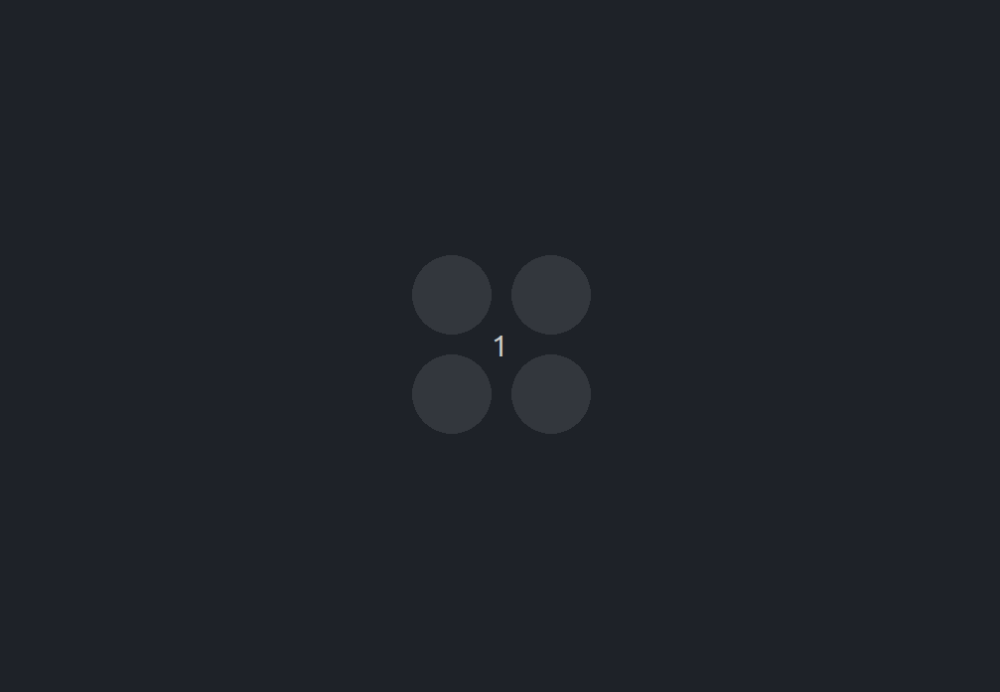
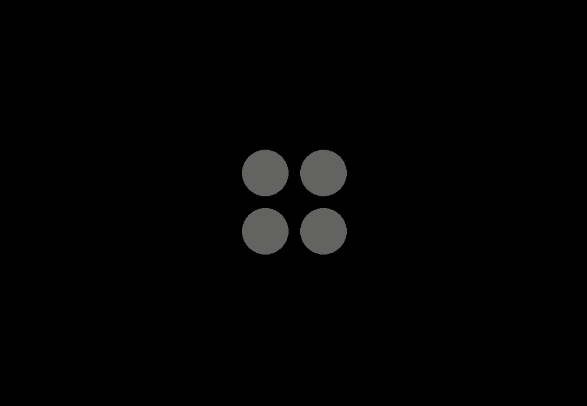
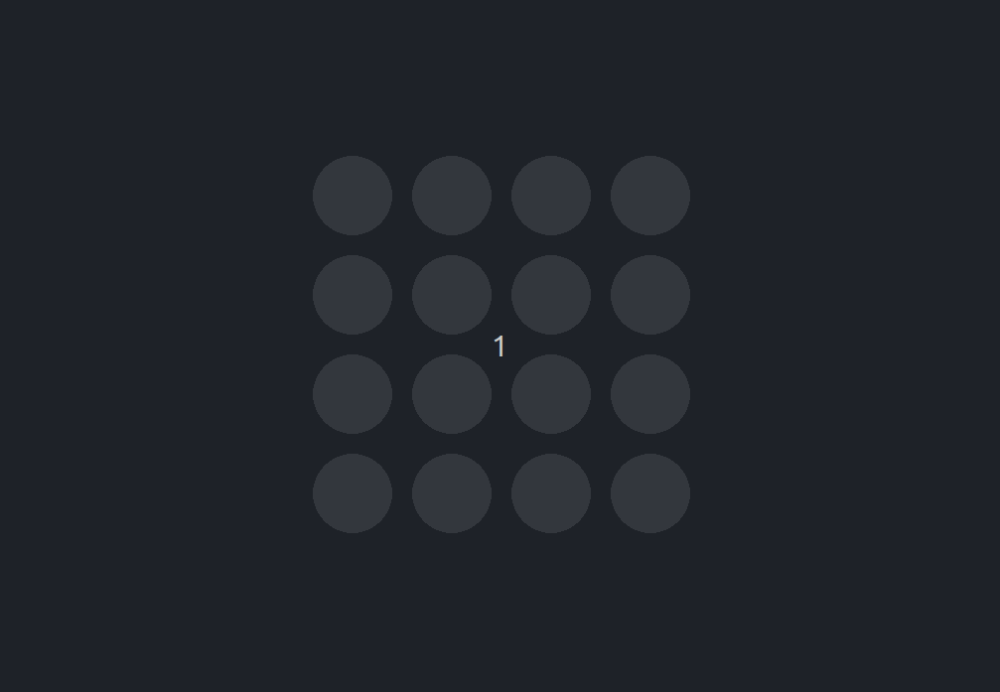

## IMPORTANTE! Entrega da Prova

Para enviar a solução desta avaliação, realize commits no repositório da avaliação ao longo da realização da prova.

É de sua responsabilidade garantir que o código seja enviado corretamente. Desta forma, antes de sair da prova, verifique se o seu código aparece no repositório do GitHub.

## Consultas permitidas na prova de Pygame

Para a realização desta prova de Pygame serão permitas as seguintes consultas:

- **Documentação do Pygame:** [https://www.pygame.org/docs/](https://www.pygame.org/docs/)
- **Conteúdo da Página da Disciplina:** É permitido consultar o conteúdo da página da disciplina.
- **Seus Checks:** 
    - É permitido consultar o código dos seus checks. Além disso é permitido adicionar ao arquivo README.md do repositório do check uma colinha com funções e comandos que desejar. Lembrando que não é permitido adicionar códigos de exercícios.
    - Você deve realizar um commit com o conteúdo que irá consultar na prova. O commit deve ser feito antes do início da prova.
    - A consulta ao repositório deverá ser feita através do navegador. Para facilitar a visualização do código, você pode acessar a página do github do reposítório e precionar a tecla `'.'` paa mudar a visualização para o VS Code.

## NÃO é permitido (será considerada infração do código de ética da instituição):
- usar smartphone ou tablet
- consultar google drive, one drive, dropbox ou qualquer ferramenta de compartilhamento de arquivos.
- consultar email, whatsapp, discord ou qualquer outra forma de comunicação direta com outras pessoas. Feche estes programas antes de começar
- pedir a outras pessoas para resolver a prova por você
- utilizar ferramentas como Chat-GPT (ferramentas que utilizem inteligência artificial)
- utilizar ferramentas de sugestão de código (como o copilot)
    - Qualquer evidência de que um plugin de inteligência artificial está ativo no editor de código será considerada uma violação a esta regra, independente do uso.
- acessar a avaliação enquanto estiver fora da sala ou já tiver informado a entrega ao professor
- usar fone de ouvido
- Falar com quem já entregou a prova antes de você haver entregado

__ 
# Jogo da Memória

Nesta avaliação de pygame faremos um jogo da memória. Nosso jogo mostra um tabuleiro de $N \times N$ peças (para os níveis básico e proficiente $N = 2$) escondidas (cinza). Ao clicar em uma peça, a sua cor é revelada. Ao clicar na segunda peça, se as cores forem iguais, ambas as peças desaparacem. Caso contrário, ambas as peças são escondidas e o jogador pode jogar novamente.

## Avaliação de funcionalidades

A avaliação está organizada em 5 níveis, cada um com uma descrição do jogo e uma animação mostrando seu funcionamento.

- **Insuficiente**: não entregou, entregou jogo que não roda ou que não está relacionado ao enunciado.
- **Em Desenvolvimento**:
    - Tentou fazer o jogo Básico, mas algo não funciona.
    - Jogo parece com o proposto, mas tem funcionamento diferente do proposto.

> :warning: Cada nível tem uma animação mostrando o funcionamento esperado. Se seu jogo não tiver a mesma mecânica do mostrado terá avaliação **Em Desenvolvimento**.

### Básico (C)

1. é criado um jogo com tela $1024\times 720$; (0.5 ponto)
    - Ao clicar no botão de fechar, o jogo é encerrado
    - O fundo da tela deve ser preenchido com a cor preta.
2. 4 peças de raio 40 pixels são criadas. Para criar as peças, siga os passos a seguir:
    - use a função `cria_tabuleiro` implementada no arquivo `utils.py` para sortear as peças (0.5 ponto)
        - a função `cria_tabuleiro` recebe como parâmetro a quantidade de peças do tabuleiro. Para o nível básico, use `2` como parâmetro.
        - Você NÃO deve modificar a função `cria_tabuleiro` 
        - essa função devolve uma lista de listas contendo cores. Cada cor ocorre exatamente duas vezes. Exemplo: `[[(255, 0, 0), (0, 255, 255)], [(0, 255, 255), (255, 0, 0)]]
    - Desenhe as peças como mostradas no exemplo (1 ponto)
        - Inicialmente todas as peças devem ser desenhadas com a cor cinza (RGB: 128, 128, 128).
        - As peças devem estar centralizadas e com espaçamento. (1 pontos)
3. Ao clicar em qualquer uma das 4 peças o jogo deve (2 pontos):
    - Revelar e manter as cores de todas as 4 peças.
    - Caso as cores já estejam reveladas, o jogo deve voltar a esconder todas as cores. 
    - Ao clicar em qualquer lugar da tela que não seja uma peça, o jogo não faz nada.
    - A menos que o jogador clique em uma peça, o jogo deve manter o estado atual (cores reveladas ou escondidas).

    

> :warning: O jogo básico não tem animação de clique individual. Se você fez um jogo que alterna a cor de uma peça por clique, sua avaliação será **Em Desenvolvimento**.

> :incoming_envelope: **Faça um commit** com a solução e verifique se o commit aparece na página do GitHub.
    

### Proficiente (B)

1. Altere o código para que a peça só alterna a cor se esta for clicada individualmente;
2. Altere o código para centralizar as peças na tela utilizando algum cálculo que utilize as medidas da largura e altura da tela.
    - Ou seja, nesta etapa, não se deve utilizar posições fixas para desenhar as peças.
    - Caso o tamanho da tela seja alterada, as peças devem continuar centralizadas.

    

> :incoming_envelope: **Faça um commit** com a solução e verifique se o commit aparece na página do GitHub.

### Avançado (A)

1. ao revelar a segunda peça:
    - se forem iguais: apaga ambas (não mostra mais nada no lugar);
    - se forem diferentes: esconde sua cor (volta a ser cinza e pode ser clicado novamente).

    

> :incoming_envelope: **Faça um commit** com a solução e verifique se o commit aparece na página do GitHub.

### Avançado+ (A+)

1. se as duas peças forem de cores diferentes, aguarda 1 segundo antes de esconder a cor;
2. utiliza um tabuleiro de $4 \times 4$ (a função `cria_tabuleiro` pode receber um número representando a quantidade de peças em um lado do tabuleiro, no caso `4`);
3. ao final do jogo (quando acabam todas as peças), mostra uma mensagem indicando que o jogador venceu.
4. O tabuleiro deve continuar centralizado na tela.

    

> :incoming_envelope: **Faça um commit** com a solução e verifique se o commit aparece na página do GitHub.
